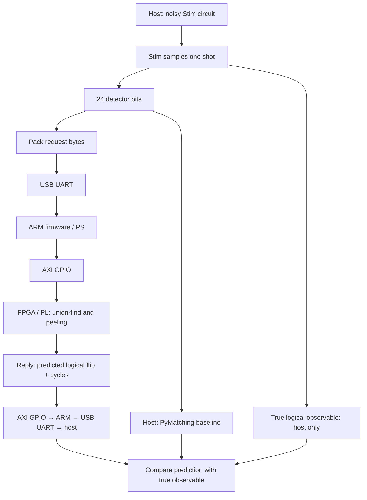

# QEC quick start: manually decode a complete window

Run all commands from the **repository root**. This guide uses the algorithmic
**surface-code sample** first (distance 3, three rounds, Z memory), then shows
how to switch to the smaller repetition-code LUT sample.

## 1. What actually happens?



**The circuit is simulated on the PC, not sent to the FPGA.** Only its detector
bits go to the board. Stim is a circuit simulator, not the decoder used for the
baseline: **PyMatching** decodes the same detector bits separately. The FPGA runs
an unweighted union-find/peeling algorithm, so it can disagree with PyMatching
without an implementation bug. For implementation correctness we compare the
FPGA with the Python version of its own algorithm.

A detector bit records a measurement-parity change relative to the circuit's
expected behavior. A complete set for one shot is the decoder input; bit i goes
in integer bit i (little-endian packing). The decoder groups detection events
using the graph, then selects correction edges by peeling a spanning forest.
The XOR of their logical-observable labels is the predicted logical flip.

Stim supplies both the detector input and the true logical flip for evaluation.
**The true flip is not sent to the FPGA.** A prediction of 1 means invert the
logical measurement interpretation; it is not a command to physically flip a
qubit. The sample does not connect to a quantum processor, execute physical
corrections, or run continuous feedback. It processes completed simulated shots.

**Agent-selected starting point:** use the surface sample to see an algorithm
run in hardware. The repetition sample instead indexes a 256-entry prediction
LUT. Their firmware, bitstreams and packet formats are incompatible.

## 2. Prepare Python (no board needed)

```sh
uv venv --python 3.12 qec/.venv
uv pip install --python qec/.venv/bin/python -r qec/requirements.txt
source qec/.venv/bin/activate
mkdir -p build
python -m pytest qec/tests -q
```

If `qec/.venv` already exists, reuse it and skip creation. Python requirements
include Stim, PyMatching, NumPy, pyserial and pytest. Vivado/Vitis are only needed
for the later RTL/build/board steps.

## 3. Manually inspect one noisy shot in software

The runnable example is already checked in as [surface/example.py](surface/example.py).
No need to create a script or an intermediate JSON file:

```sh
python -m qec.surface.example
python -m qec.surface.example --circuit
```

The first command shows one nonzero detector window from 256 seeded shots.
The second prints the **entire actual circuit**, including its noise instructions.
The following small snippets explain the same example; they are not separate
scripts you need to save.

### 3a. What circuit, and where are the errors?

This is a distance-3 rotated surface-code **Z-memory experiment**: initialize nine
data qubits in Z, measure parity checks for three rounds using eight ancillas,
then measure the data in Z. The final data measurements also contribute detectors
and one logical observable. The hardware graph was generated for this circuit:

```python
circuit = stim.Circuit.generated(
    "surface_code:rotated_memory_z", distance=3, rounds=3,
    after_clifford_depolarization=0.001,
    before_round_data_depolarization=0.001,
    before_measure_flip_probability=0.001,
    after_reset_flip_probability=0.001,
)
```

Each parameter inserts stochastic noise instructions at the named locations;
0.001 is a probability **per specified noise location**, not per shot. For
example, here are consecutive instructions from the actual circuit:

```text
R 1 3 5 8 10 12 15 17 19
X_ERROR(0.001) 1 3 5 8 10 12 15 17 19
R 2 9 11 13 14 16 18 25
X_ERROR(0.001) 2 9 11 13 14 16 18 25
TICK
DEPOLARIZE1(0.001) 1 3 5 8 10 12 15 17 19
H 2 11 16 25
DEPOLARIZE1(0.001) 2 11 16 25
TICK
CX 2 3 16 17 11 12 15 14 10 9 19 18
DEPOLARIZE2(0.001) 2 3 16 17 11 12 15 14 10 9 19 18
```

`R` resets to zero; `H` and `CX` are ideal gates. `X_ERROR(p)` independently
applies X to each listed qubit with probability p. `DEPOLARIZE1(p)` chooses a
nonidentity single-qubit Pauli with total probability p; `DEPOLARIZE2(p)` does
the same over the 15 nonidentity two-qubit Paulis for each listed pair. `TICK`
separates circuit steps. Noise is sampled during simulation: there is no later
step that randomly edits detector bits.

Later, a round-to-round detector instruction such as
`DETECTOR(2, 0, 0) rec[-8] rec[-16]` checks the XOR of two recorded measurements;
`rec[-1]` means the most recent measurement. A detector fires when that parity
differs from its noiseless expectation. `OBSERVABLE_INCLUDE(0)` marks the parity
used for the true logical observable. Neither instruction performs decoding.

For exact reproducibility, the example loads the circuit text from the committed
`d3_z_r3.json` instead of regenerating it with a possibly different Stim version:

```python
config = json.loads(Path("qec/surface/graphs/d3_z_r3.json").read_text())
circuit = stim.Circuit(config["circuit"])
```

### 3b. Sample a shot, then pack the detector bits

```python
detectors, observables = circuit.compile_detector_sampler(seed=20261107).sample(
    256, separate_observables=True
)
index = next(i for i, row in enumerate(detectors) if row.any())
bits = detectors[index]
syndrome = sum(int(bit) << i for i, bit in enumerate(bits))
```

We pick a nonzero window so there is something to decode, not to estimate an
error rate. With the installed versions, this selects shot 11 (zero-based): only
detector 11 fires, so `syndrome = 2048 = 0x000800`. Its true observable is 0.
Seeded output can change across Stim versions; use your printed result if it does.
The true observable stays on the host and is **not** packed into the request.

### 3c. Decode and distinguish the three comparisons

```python
result = decode(config["detectors"], config["edges"], syndrome)
matching = pymatching.Matching.from_detector_error_model(
    circuit.detector_error_model(decompose_errors=True)
)
baseline = int(matching.decode(bits)[0])
logical_error = result["prediction"] != int(observables[index, 0])
```

For the shot above, the Python union-find result is `prediction=0`,
`correction_edges=[47]`; PyMatching also predicts 0. Both agree with the true
observable, so neither has a logical error on this shot.

- **FPGA versus Python union-find:** checks the hardware implementation.
- **FPGA versus PyMatching:** compares two different decoding algorithms.
- **Either prediction versus Stim's observable:** checks logical success.

The example also checks that the selected edges cancel the detector parity
(`residual=0`). This does **not** guarantee the correct logical answer: different
physical errors can produce the same detectors. The board returns the prediction
and cycle count, not the correction-edge list.

## 4. Run the actual RTL before using a board

These commands use the installed AMD 2025.2 tools. Adjust paths for your machine.
The current `surface/sim.py` itself expects `$HOME/amd/2025.2/Vivado/bin`.

```sh
VIVADO="$HOME/amd/2025.2/Vivado/bin"
VITIS="$HOME/amd/2025.2/Vitis/bin"

python qec/surface/sim.py --distance 3 --basis z --shots 256 > build/surface_sim_d3.log 2>&1
python qec/surface/sim.py --distance 5 --basis z --shots 128 > build/surface_sim_d5.log 2>&1
python qec/surface/sim.py --distance 3 --basis x --shots 128 > build/surface_sim_x.log 2>&1
$VIVADO/xvlog --sv rtl/common/surface_decoder.sv rtl/common/surface_ps_bridge.sv qec/surface/tb_bridge.sv
$VIVADO/xelab tb_surface_bridge -s surface_bridge
$VIVADO/xsim surface_bridge -runall > build/surface_bridge_sim.log 2>&1
```

Run each command only after the previous one succeeds. Core logs must contain
`PASS algorithmic surface`; the bridge log must contain
`PASS surface AXI GPIO bridge`. Reject any `Fatal:`/`FATAL`, even if xsim exits
zero. The core runner checks these markers automatically. Keep the d3 Z run at
256 shots: the bridge bench reads its generated 423-case vector file.
The d5/X runs validate RTL configurations, **not** those configurations on board.

## 5. Build and load the surface SoC

Use a **Zybo Z7-10**, powered and connected through **PROG/UART USB**. This
USB-only design uses the ARM's UART; no Pmod wiring is needed. Install the
Digilent Zybo board files and AMD cable drivers if not already available.

```sh
$VIVADO/vivado -mode batch -source scripts/build_soc.tcl -tclargs top_surface_soc > build/surface_build.log 2>&1
$VITIS/vitis -s vitis/surface/build_app.py > build/surface_firmware_build.log 2>&1
```

Require successful builds and the actual files `build/surface_soc.bit`,
`build/surface_soc.xsa`, and
`build/vitis_ws/surface_app/build/surface_app.elf` before proceeding. Review
build errors/DRCs and routed timing reports; a checkpoint is not a bitstream.

Discover the serial port (do not assume it is always `/dev/ttyUSB1`):

```sh
python -m serial.tools.list_ports -v
```

The board's FTDI UART was `/dev/ttyUSB1` in archived runs; its recorded board
serial was `210351BE7C3EA`. Use your actual UART port and board serial below.
Close any serial monitor before running a host script. Ensure your account has
serial-device access (commonly membership in `dialout`; log in again after a
membership change).

**The next command replaces the running FPGA design and restarts ARM core 0.**
It loads volatile state over JTAG; it does not write flash or SD storage.

```sh
$VITIS/xsct scripts/run_soc.tcl build/surface_soc.bit build/vitis_ws/surface_app/build/surface_app.elf build/surface_soc.xsa > build/surface_program.log 2>&1
$VIVADO/vivado -mode batch -source scripts/qec_readback.tcl > build/surface_readback.log 2>&1
```

Require successful programming and configuration status DONE=1, INIT_B=1,
CRC_ERROR=0 in the readback log. This checks configuration status, not full
bitstream-memory readback or successful decoding. Power loss requires reloading.

## 6. Send exactly the window you inspected

Run the **same checked-in example** with a port after loading the matching
surface image. It deterministically regenerates the same shot; no saved-window
file is needed. This sends a real binary request, not a text-terminal command:

```sh
PORT=/dev/ttyUSB1  # replace with the discovered board UART
BOARD_ID=210351BE7C3EA  # replace with your board's serial
python -m qec.surface.example --port "$PORT"
```

### 6a. Build the request

```python
seq = 0
tx = request(seq, syndrome)
```

For the software example's `syndrome=0x000800`, `tx.hex(" ")` is:

```text
c3  00  03  00 08 00  c8
│   │   │   └──────── 24 detector bits, little-endian
│   │   └──────────── payload length: 3 bytes
│   └──────────────── sequence: 0
└──────────────────── request header
                      c8 = XOR of all preceding bytes
```

### 6b. Send and read the reply

```python
with serial.Serial(args.port, 115200, timeout=1, write_timeout=1) as port:
    port.reset_input_buffer()
    assert port.write(tx) == len(tx)
    rx = port.read(9)
prediction, cycles = parse(rx, seq)
```

The request travels through USB UART → ARM firmware → AXI GPIO → PL. The return
path reverses those steps. `parse()` checks length, header, checksum, sequence,
success status and the one-bit prediction. A timeout or wrong image is an error;
the example never substitutes a software reply.

Here is a **real archived board transaction for the same syndrome** from
[surface/results/hardware-d3-z-p001/transactions.csv](surface/results/hardware-d3-z-p001/transactions.csv),
row `index=397`. It used sequence `0x8d`, not the example's sequence zero:

```text
TX: c3 8d 03 00 08 00 45
RX: 3c 8d 00 00 a9 03 00 00 1b
    │  │  │  │  └────────── cycles: 0x000003a9 = 937
    │  │  │  └───────────── prediction: 0
    │  │  └──────────────── status: 0 (success)
    │  └─────────────────── echoed sequence: 0x8d
    └────────────────────── reply header
                            1b = XOR of preceding reply bytes
```

Your new run prints its own `rx_hex`, `board_prediction` and `pl_cycles`.
The example asserts that the board agrees with the Python union-find reference
and reports a positive cycle count. Compare its prediction with `observable`
for logical success, not merely with `pymatching`.

Request: `C3 | sequence | payload-length=03 | 3 syndrome bytes | XOR checksum`.
Reply: `3C | sequence | status | prediction | 4 cycle bytes | XOR checksum`.
Multi-byte fields are little-endian. Core time in ns is `cycles * 10` for the
configured 100 MHz FCLK; the archived 937-cycle example is 9370 ns. This excludes
host, USB, UART, ARM and AXI time.

## 7. Run and inspect the complete captured experiment

After **all** simulation/build/program/readback steps above, run:

```sh
python qec/surface/host.py --port "$PORT" --board-id "$BOARD_ID" --shots 4096 --noise .001 --seed 20261107 --out build/manual-surface-run
```

Use a fresh output directory every time. The runner first checks zero, single
detectors, graph-edge syndromes and dense windows, then samples and decodes the
Stim shots. It also tests malformed-packet recovery and explicit PL reset.
The `--board-id` value is an archive label, not automatic board identification.

Inspect `build/manual-surface-run/summary.json` and `transactions.csv`:

- `uf_mismatches` must be zero: hardware agrees with this algorithm's reference.
- `logical_errors` counts FPGA predictions different from true Stim observables.
- `pymatching_logical_errors` is a weighted matching baseline; disagreements with
  this different algorithm are not automatically RTL failures.
- `cycles_min/median/max` measures the PL boundary; `host_stim_ns_median` includes
  the serial transaction. Do not interpret one as the other.
- Only `kind=stim` CSV rows support sampled logical-error statistics. Other rows
  are diagnostics. `manifest.json` hashes the archived files.

The capture runner also copies all three simulation logs, bridge log, build and
program/readback logs, timing/utilization reports, bitstream, XSA and ELF. Missing
prerequisite artifacts can fail archiving **after** transactions have run; do not
skip earlier steps or reuse stale logs from another build. Avoid source edits
between build and capture: its source snapshot is `git archive HEAD`, with dirty
status recorded separately. There is no software-loopback fallback in this path.

## 8. Prefer the smaller repetition-code sample?

For a no-board software demo:

```sh
python qec/host.py --mode loopback --shots 20000 --seed 90210
```

For actual board decoding, replace **both** the surface bitstream and firmware:

```sh
$VIVADO/vivado -mode batch -source scripts/build_soc.tcl -tclargs top_qec_soc > build/qec_soc_build.log 2>&1
$VITIS/vitis -s vitis/qec/build_app.py > build/qec_firmware_build.log 2>&1
$VITIS/xsct scripts/run_soc.tcl build/qec_soc.bit build/vitis_ws/qec_app/build/qec_app.elf build/qec_soc.xsa > build/qec_program.log 2>&1
$VIVADO/vivado -mode batch -source scripts/qec_readback.tcl > build/qec_readback.log 2>&1
python qec/hardware_run.py --port "$PORT" --board-id "$BOARD_ID" --shots 4096 --noise .001 --seed 20261105 --out build/manual-repetition-run
```

Apply the same build/configuration checks as above before sending requests.
This sample packs eight detectors into one byte; the PL looks up a logical flip
in `qec/lut.mem`. The runner exhausts all 256 inputs, samples real Stim shots,
and checks malformed-frame recovery. Evaluate sampled accuracy under the
summary's `stim` object, not the diagnostic `exhaustive` object. Its four-byte
request/six-byte response is **not** the surface protocol. To return to surface,
repeat the surface load command in step 5 with its own bitstream, ELF and XSA.

## Troubleshooting and further reading

- **No UART/JTAG device:** check board power, data-capable USB cable, drivers and
  permissions. Seeing a UART does not establish a working JTAG connection.
- **Timeout/invalid reply:** close serial monitors; confirm port, 115200 baud,
  successful ARM start, and matching bitstream/firmware/host. Do not assume the
  previously loaded image survived a power cycle.
- **Prediction differs from Stim but matches reference:** possible decoder error;
  syndrome agreement alone does not establish logical success.
- **Want PL-only UART?** That separate design needs a 3.3 V TTL adapter on
  JE1/V12 (FPGA RX), JE2/W16 (FPGA TX), and ground. The onboard USB UART does
  not directly reach those PL pins. `scripts/qec_build.tcl` is report-only,
  not a replacement for the SoC bitstream build.

See [surface/README.md](surface/README.md) for scope and archived board results,
[surface/decoder.py.md](surface/decoder.py.md) for the algorithm,
[surface/host.py.md](surface/host.py.md) for capture details, and
[README.md](README.md) for the repetition baseline.
